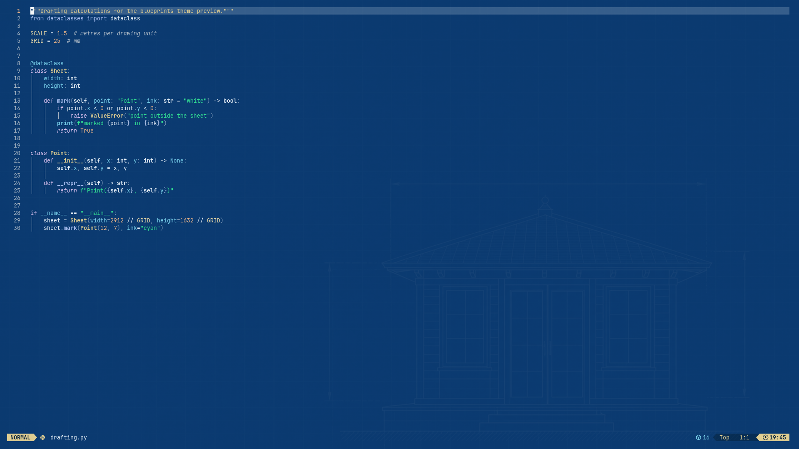

# Blueprints

Blueprints turns an Omarchy 4 desktop into an engineering cyanotype: deep Prussian-blue surfaces, near-white drafting lines of text, and a full-color syntax palette held at matched legibility so no token reads fainter than another. The theme is a single semantic `colors.toml` — Omarchy generates every editor, terminal, and shell config from it.



## Install

**Requirement:** Omarchy 4.x. Blueprints uses the Omarchy 4 semantic `colors.toml` key set and will not install into a 3.x-style theme layout.

From the Omarchy menu, follow **Install → Style → Themes** and pick **Blueprints**. From a terminal, the same thing is:

```sh
omarchy theme install https://github.com/boundring/omarchy-blueprints-theme.git
omarchy theme set blueprints
```

The slug `blueprints` is derived from the repository name by stripping the `omarchy-` prefix and the `-theme` suffix, so the repository has to stay named `omarchy-blueprints-theme` for the commands above to work unchanged.

Installed themes live in `~/.config/omarchy/themes/`; switching applies the palette, regenerates the terminal and editor configs, and picks up the default wallpaper from the theme's `backgrounds/`. Omarchy 4 is required because it introduced the semantic `colors.toml` key set — older releases shipped per-app color files instead, so a 4.x theme has nothing a 3.x install can consume.

To install from a local copy instead of a git URL:

```sh
cp -r /path/to/omarchy-blueprints-theme ~/.config/omarchy/themes/blueprints
omarchy theme set blueprints
```

## Palette

`mode` is `dark`; the twenty-five color keys plus the active-border gradient below make up the rest of the theme, named by role rather than by terminal slot. Values are exactly what ships in `colors.toml`. `hyprland_active_border` is the one key that is not a hex — Hyprland gradient strings carry their own alpha values and angle.

| Key | Value | Role |
| --- | --- | --- |
| `mode` | `dark` | Selects the dark variant of every generated config. |
| `darker_background` | `#041f3a` | Recessed surfaces: wells and embedded panels, the deepest step of the ramp. |
| `dark_background` | `#072c52` | One step above the recess; unfocused chrome. |
| `background` | `#0b3a70` | The canvas — the default editor and desktop surface. |
| `lighter_background` | `#144876` | Raised surfaces: floats, tooltips, `NormalFloat`. |
| `foreground` | `#f2f8fd` | Body text; the drafting line. |
| `bright_foreground` | `#ffffff` | Emphasis text; ANSI 15. |
| `light_foreground` | `#cfe2f2` | Secondary text. |
| `dark_foreground` | `#a9c7e2` | Tertiary text. |
| `muted` | `#b0bbc6` | Comments and de-emphasis; ANSI 8. |
| `accent` | `#7ad4f5` | Interactive accent; start color of the active window border. |
| `selection` | `#1c5c9c` | Selection background; quiet against the canvas, high-contrast under white text. |
| `red` | `#f5afab` | Chromatic; ANSI 1. |
| `orange` | `#f7ba88` | Chromatic; editor numbers. |
| `yellow` | `#ebd592` | Chromatic; ANSI 3; inverted search-match background. |
| `green` | `#35ea94` | Chromatic; editor strings; ANSI 2. |
| `cyan` | `#7dd5ee` | Chromatic; types and library functions; ANSI 6. |
| `blue` | `#b3c6f7` | Chromatic; editor functions; ANSI 4. |
| `magenta` | `#e1b4f4` | Chromatic; ANSI 5. |
| `brown` | `#dbb28f` | Chromatic; the warm earth tone of the set. |
| `bright_red` | `#f8c5c2` | Chromatic; ANSI 9. |
| `bright_yellow` | `#efdda8` | Chromatic; ANSI 11. |
| `bright_green` | `#4ceca0` | Chromatic; ANSI 10. |
| `bright_cyan` | `#94dcf1` | Chromatic; ANSI 14. |
| `bright_blue` | `#cad7f9` | Chromatic; ANSI 12. |
| `bright_magenta` | `#eacaf7` | Chromatic; editor keywords; ANSI 13. |
| `hyprland_active_border` | `rgba(7ad4f5ee) rgba(f2f8fdee) 45deg` | Active window border: 45° cyan-to-white gradient. |

`accent` and `selection` complete the interactive pair: `accent` draws attention (borders, active elements), `selection` holds it (the region you dragged over).

## Contrast

Contrast is the WCAG relative-luminance ratio of each token against the two surfaces that carry text.

Read the table as guarantees: if you extend or restyle the palette, re-measure against both surfaces, not just the canvas — the raised surface is always the tighter of the two.

| Token | on `background` | on `lighter_background` |
| --- | --- | --- |
| `foreground` | 10.59 | 8.84 |
| `bright_foreground` | 11.33 | 9.47 |
| `light_foreground` | 8.53 | 7.13 |
| `dark_foreground` | 6.45 | 5.39 |
| `muted` | 5.81 | 4.85 |
| `accent` | 6.78 | 5.66 |
| `red` | 6.26 | 5.23 |
| `orange` | 6.65 | 5.56 |
| `yellow` | 7.80 | 6.52 |
| `green` | 7.20 | 6.02 |
| `cyan` | 6.81 | 5.69 |
| `blue` | 6.66 | 5.56 |
| `magenta` | 6.49 | 5.43 |
| `brown` | 5.81 | 4.86 |
| `bright_red` | 7.42 | 6.20 |
| `bright_yellow` | 8.41 | 7.02 |
| `bright_green` | 7.45 | 6.23 |
| `bright_cyan` | 7.43 | 6.21 |
| `bright_blue` | 7.88 | 6.58 |
| `bright_magenta` | 7.71 | 6.44 |

Every chromatic token clears the WCAG AA threshold of 4.5:1 on both surfaces; the dimmest tokens in the set, `muted` (5.81 / 4.85) and `brown` (5.81 / 4.86), still sit a comfortable step above it. Body text clears 10:1 on the canvas. `lighter_background` is measured alongside `background` because floats, tooltips, and NeoVim's `NormalFloat` render on the raised surface — the surface most palettes forget to check, which is how popups end up washed out or illegible in otherwise careful themes.

The selection is verified in both directions: `selection` `#1c5c9c` sits 1.65:1 off the canvas — visible but quiet — while white text on it reaches 6.86:1. Inside a float the same selection drops to 1.38:1 against `lighter_background`; the white text on it is unchanged at 6.86:1. The surface steps themselves stay deliberately close, 1.20:1 between canvas and raised and 1.24:1 between canvas and the unfocused `dark_background` step, because panel boundaries in this theme are drawn by position and the accent border rather than by luminance jumps.

## Design

Three decisions carry the look: one hue for every surface, syntax in full color at matched legibility, and warmth pulled back from neon. The rest is restraint.

### The cyanotype surface ramp

Blueprints uses four surfaces in a single hue: `darker_background` `#041f3a` → `dark_background` `#072c52` → `background` `#0b3a70` → `lighter_background` `#144876`. Adjacent steps stay close in luminance — 1.20:1 from canvas to raised, 1.24:1 from canvas to the unfocused step, and 1.47:1 from canvas to the recess — enough to trace panel edges without competing with the text on them. On top of that ramp, the near-white `foreground` is the drafting line: ink drawn on a blue print, the way white lines sit on a cyanotype.

Because all four surfaces share one hue, windows dock and float without the color clashes that multi-hue surface ramps produce.

### Full-color syntax at matched legibility

The eight chromatics are deliberately narrow in contrast — held between roughly 5.8:1 and 7.8:1 on the canvas — so no token is a weak channel and none shouts over the others. Roles follow the Omarchy 4 editor template, and all three editors agree: comments use `muted`, functions `blue`, strings `green`, numbers `orange`, types `yellow`, and keywords `bright_magenta`. `cyan` has narrower duties: in VS Code it colors `function.defaultLibrary` (which Neovim's pinned colorscheme leaves falling back to function blue), and in Helix it colors enum variants. One inversion is intentional: the selection pairs `selection` under white text at 6.86:1. Search behaves differently per surface — terminals invert it, so Alacritty, foot, and kitty paint matches `yellow` with `background`-colored text and the focused match `red`, while Neovim's pinned aether colorscheme washes the search background blue under normal text and paints incremental and current search `orange`. The terminal follows the same contract — ANSI 0 is `background`, 7 is `foreground`, 8 is `muted`, 15 is `bright_foreground`.

A common dark-theme shortcut is to de-saturate syntax until it is nearly monochrome with one accent. Blueprints does the opposite: every token keeps a full hue, and the matched contrast band is what keeps that much color from turning into noise.

### Warm hues on a cold ground

Against a saturated Prussian-blue ground, neon warm hues vibrate: the eye generates afterimages along the blue/orange axis and thin glyphs smear. The warm tokens — `red`, `orange`, `yellow`, `brown`, and their bright variants — are therefore tuned pastel-ward, pulled toward white until the complementary contrast against the blue stays crisp but stops shimmering. The result reads like chalk and pencil annotation on a print rather than glow-in-the-dark console colors.

The cool tokens do not need the same treatment: `cyan` and `blue` already sit near the ground hue, so they are simply lightened toward white, where they read as chalk highlights on the print rather than rivals to it.

## What it ships

- `colors.toml` — the entire theme.
- `backgrounds/` — three wallpapers (below).
- `preview.png` and `palette-check.png` — the images on this page.

Nothing in the repository executes on your machine: no `.lua`, no terminal configs (`alacritty.toml`, `foot.ini`, `ghostty.conf`, `kitty.conf`), no `vscode.json`. When `omarchy theme install` clones a theme it keeps only the color files, and Omarchy regenerates everything else from `colors.toml` — so those files are intentionally absent here.

If you fork or restyle the theme, `colors.toml` is the only file to edit; `preview.png`, `palette-check.png`, and the backgrounds are rendered artifacts of it, and everything Omarchy generates downstream follows from it.

One compositor value is themed: `hyprland_active_border`, a 45° cyan-to-white gradient (`rgba(7ad4f5ee) rgba(f2f8fdee) 45deg`) on the focused window. Window metrics — gaps, border size, rounding — are machine configuration in `~/.config/hypr/looknfeel.lua` and out of a theme's scope.

## Backgrounds

| File | Scene |
| --- | --- |
| `backgrounds/1-drafting-grid.jpg` | Cyanotype grid sheet with a pavilion elevation and dimension lines in the lower right. The default wallpaper; it sorts first. |
| `backgrounds/2-elevation.jpg` | White-line architectural elevation with dimension lines. |
| `backgrounds/3-assembly.jpg` | Exploded mechanical detail — gears, brackets and bearings strung along leader axes. |

Each wallpaper is drawn from the theme palette itself — the same Prussian blues and white line work as the desktop — so bars and terminals sit on them without contrast surprises.

All three are 2912×1632 JPEGs, each kept light (capped at roughly 2 MB) — JPEG also keeps the halftone shading and paper grain smooth. Cycle between them with **Super+Ctrl+Space**. Your own images dropped into `~/.config/omarchy/backgrounds/blueprints/` appear alongside the shipped set.

## palette-check.png

`palette-check.png` renders the palette into a simulated bar, terminal, menu, and notification so the relationships — surface ramp, matched chromatic legibility, inverted terminal search (Alacritty-style, in the terminal panel only) — can be judged without installing.

## License

MIT — see [LICENSE](LICENSE).
